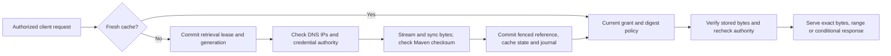

# Governed proxy and group operations

Generic, Maven, npm, PyPI and OCI have early hosted/proxy/group implementations.
Native metadata and graph rules differ by format; see the npm, Python and OCI
operator guides for their tested operations and open limits. This document does
not qualify full format parity or production.

A **proxy** copies a requested package from one configured source. A **group**
tries approved source repositories in an explicit order. Every download still
checks the caller's authority and the decision on the exact SHA-256 bytes. A cache
state of `ready` means durable bytes are cached; those bytes can still be quarantined.



The retrieval **generation** is a counter. A worker must present the generation
and private lease token it acquired. If a later worker or an operator expires
that operation, the old worker cannot publish its result. After a process crash,
an expired lease can be reclaimed. A live lease causes bounded waiting and then
HTTP 503 with `Retry-After: 1`; this is not a completed download.

## Configure a public Maven proxy

Create the following JSON in a workspace file and use the management CLI with
POST `/api/v1/repositories` and a stable idempotency key:

```json
{
  "name": "maven-central",
  "format": "maven",
  "mode": "proxy",
  "access": "tenant",
  "require_review": true,
  "settings": {
    "upstream": {
      "url": "https://repo.maven.apache.org/maven2/",
      "networks": ["0.0.0.0/0", "::/0"]
    },
    "cache": {
      "fresh_seconds": 300,
      "negative_seconds": 30,
      "stale_seconds": 0,
      "require_checksum": true,
      "allow_no_store": false
    }
  }
}
```

These CIDRs permit public IPv4/IPv6 addresses. Private, loopback and link-local
addresses are independently blocked unless the server operator authorizes them
with `--allow-private-upstreams`. DNS results are checked on every new connection;
the socket connects to a checked IP, and HTTPS verifies the original hostname
using the host's configured CA trust. An existing connection stays bound to its
already checked IP. Environment HTTP proxies are not used.

The default freshness/negative/stale values are zero when omitted, so specify the
windows you want. Current validation allows freshness through one day, negative
caching through one hour and stale windows through seven days. These are initial
safety bounds, not license/edition controls; broader operator configuration remains
required. Admission budgets are configured with `--transfer-concurrency` (16),
`--proxy-concurrency` (4) and `--tenant-proxy-concurrency` (32). Keep a request slot
outside proxy work. Fair scheduling across tenants is not yet qualified.

Maven intake checks SHA-256 or SHA-1 source sidecars. A mismatch publishes no
reference. If `require_checksum` is false, missing source sidecars are recorded as
unavailable, never as verified. Partial responses and unexpected encodings are not
published. Changed bytes lose previous manual approval; unchanged bytes retain it.

Source cache-control directives can shorten the window; `must-revalidate` prevents
stale serving. Source `no-store` rejects byte storage unless an operator explicitly
sets `allow_no_store`. The local conformance fixture uses that override for its own
private repository bytes. This is a controlled repository copy, not an unrestricted
HTTP cache. Redirects must remain in the same scheme, authority and base path.
Cross-authority CDN redirects and general signed-query download URLs remain open.

## Bind private upstream credentials

Credentials belong in a server-side JSON file with mode 0600, loaded with
`--upstream-credentials`. Each key is `TENANT/REFERENCE`. Its object has `value`,
`allowed_url` and optional `authentication` (`bearer`, the default, or `basic`).
For Basic authentication, the private value is `username:password`. Use a
customer-managed secret provisioning process to write actual values; never put
those values in API JSON, shell arguments, event records or repository URLs.

Repository configuration contains only `credential_ref` and matching
`authentication`. The server refuses references from another tenant, another
scheme/host/port, a path outside `allowed_url`, or another authentication scheme.
The server operator owns both the credential binding and the private-network
ceiling. A tenant administrator's repository allowlist can only narrow that ceiling.
Reconfiguration currently requires a server restart; live credential rotation and
versioned source configuration remain required work.

## Restrict repositories and select sources

`access: tenant` preserves ordinary tenant role permissions. `access: restricted`
requires an explicit actor grant, except the tenant administrator. PUT
`/api/v1/repositories/NAME/grants` with an idempotency key and JSON fields `actor`,
`read`, `write`. Write also requires read plus a writer/admin service-token role.
On a restricted repository, setting both booleans false revokes that actor.
Tenant-wide access and tenant-administrator authority are unaffected by that
individual grant record. The full tenant audit journal
requires an administrator; readers cannot inspect unrelated restricted packages.

A Maven group can use the following settings:

```json
{
  "members": ["internal", "maven-central"],
  "namespace_owners": {"com/example/": "internal"}
}
```

The sources must exist in the same tenant, use the same format, and currently
cannot themselves be groups. The caller needs permission on the group and each
consulted source. Only a not-found result permits fallback; denial, unavailable
sources and checksum failures stop resolution. The longest matching namespace
owner prevents public fallback even if the owned internal package is absent.
A group can require stronger review; it cannot weaken source policy.

Current groups select the first matching path. Maven metadata union/merge and the
complete snapshot/group campaign remain unfinished, as do recursive groups and
per-content selectors. These limits stay open in the capability ledger.

## Explain and recover a request

- GET `/api/v1/repositories/NAME/cache?path=COORDINATE` shows the retrieval state,
  generation, freshness/stale deadlines and last upstream status/error. It never
  returns lease tokens or credential values.
- PUT the same `/cache` path with JSON `{"path":"COORDINATE"}` and an idempotency
  key to expire the entry and fence an in-flight worker. The response means the
  next authorized request will retrieve/revalidate; it does not claim work ran.
- `Cache-Control: no-cache` on an ordinary download requests upstream revalidation.
- `X-Cratectl-Cache` identifies `hit`, `filled`, `revalidated` or explicit `stale`.
  `X-Cratectl-Repository` identifies the selected authority within the tenant.
- Stale serving requires a configured window and an observed transient failure.
  Current denial or required review still wins. Authentication rejection, authority
  violations and known checksum mismatch cannot use stale bytes.
- HTTP 403: inspect both repository grants and the exact digest decision. HTTP 502:
  inspect the cache state, approved source, credential binding and checksums.
  HTTP 503 with Retry-After: wait for the bounded retrieval/admission lane.

Lease lifetime is currently 150 seconds and upstream work has a 120-second budget.
SQL locks are bounded at five seconds and statements at thirty seconds. These
budgets, cache retention/reconciliation, interrupted multi-node retrieval and
complete large-object campaigns still require production qualification. Pending
outbox rows now have the [dedicated worker](jobs.md) for event projection and
storage-integrity checks. Scanner, external-delivery and cleanup handlers remain
unimplemented; their effects must not be inferred from those builtin jobs.
